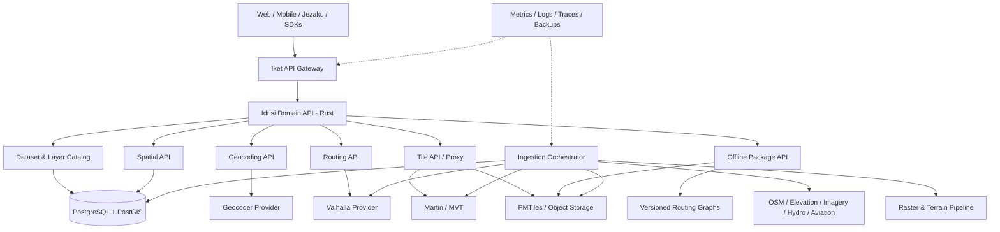

# Idrisi System Architecture

## 1. Purpose and scope

Idrisi provides self-hosted geospatial capabilities behind stable APIs. Indonesia is the initial operating region. Chart coverage is broad by design, but individual domains are enabled only when a suitable source dataset, license, processing workflow, and quality policy are in place.

Supported domains:
- Road/street and points of interest
- Topographic and elevation
- Satellite/aerial imagery
- Nautical/hydrographic
- Aviation/aeronautical
- Custom customer- or operator-managed overlays

Idrisi is not initially intended to replace the mature GIS ecosystem. It coordinates and productizes proven storage, rendering, routing, and geospatial processing engines.

## 2. Design goals

- Self-hostable with Docker Compose on a single machine or server.
- Rust-first for Idrisi-owned domain services and contracts.
- Engine/provider agnostic.
- Versioned datasets and reproducible ingestion.
- Online and offline map distribution.
- Clear separation between public APIs, internal services, and data engines.
- Operational observability, backup, restore, and security from the beginning.

## 3. Logical architecture

The diagram is conceptual. Individual services may be co-located in the initial Docker Compose deployment.

## 4. Service responsibilities

### Iket API gateway

Iket is the only public gateway and is maintained independently at https://github.com/andalus-ai/iket. It owns public ingress, TLS, upstream routing, configured authentication/API-key policies, rate limits, traffic controls, and gateway administration. Keep its management/admin surfaces private and protected by the deployed version's supported controls.

Do not create a second public gateway inside Idrisi. The gateway should not contain heavy geospatial algorithms.

### Dataset and layer catalog

Stores dataset metadata, layer definitions, source attribution, license, coverage, temporal validity, versions, publication state, and service capabilities. PostGIS is the initial metadata and spatial query store.

### Spatial storage

PostgreSQL + PostGIS stores dynamic/editable features, operational metadata, geofences, and queryable vector datasets. Large immutable source archives and generated assets belong in filesystem/object storage, not database blobs by default.

### Vector tiles

Martin is the initial MVT server candidate for PostGIS-backed dynamic layers. PMTiles provides immutable, range-readable regional archives for static datasets and offline distribution. The gateway may authorize and proxy tile requests, while static package delivery can use a compatible object store or reverse proxy.

### Raster, satellite, and terrain

Use GDAL and PROJ-based tooling for ingestion, reprojection, tiling, mosaicking, and validation. Prefer cloud-optimized formats such as COG for raster storage and a documented tile-serving component for raster/terrain delivery. The specific renderer is a replaceable provider decision, not a public API dependency.

### Routing

Valhalla is the first integration target because it provides a mature routing service with multimodal capabilities. Idrisi defines its own route and matrix contracts and translates to/from Valhalla. Keep OSRM and GraphHopper as future alternatives behind the same provider interface.

Road routing must use a graph built from an explicitly versioned road dataset. Graph updates are separate from map tile updates and must be published atomically with metadata identifying the graph's source version.

### Geocoding

Define forward search, reverse lookup, and autocomplete contracts. Nominatim is a candidate initial self-hosted OpenStreetMap geocoder; Pelias may be evaluated for broader multi-source indexing. Keep provider attribution and source limitations in results where required.

### Offline packages

Publish signed or checksum-verified regional packages containing the required map assets and metadata. Routing graph bundles are separate artifacts with compatibility metadata. Clients must be able to inspect package version, extent, layers, size, checksum, and update availability before download.

## 5. Data flow

1. Register a source and record its license, attribution, coverage, version, and acquisition method.
2. Acquire source data into a staging area.
3. Validate checksums, file integrity, CRS, coverage, and schema.
4. Normalize or transform data using reproducible processing recipes.
5. Build target artifacts: PostGIS tables, MVT/PMTiles, COG/raster tiles, geocoder indexes, or routing graphs.
6. Run quality checks and compare output metadata to the intended release.
7. Publish a new immutable dataset version and update catalog pointers atomically.
8. Retain the prior known-good version for rollback according to retention policy.

## 6. Chart/layer model

A chart is a client-facing composition of one or more layers, not a monolithic dataset. Each layer declares:
- ID, title, domain, and layer type
- Provider and dataset version
- Spatial/temporal coverage
- CRS and scale/zoom range
- Style or rendering configuration
- Attribution and license
- Visibility and access policy
- Freshness/quality status

Layer domains are extensible. The initial platform should implement common vector and raster layer primitives first; nautical and aviation layers must carry additional authority, validity, and safety metadata.

## 7. Coordinate and geospatial conventions

- Default interchange CRS: WGS 84 / EPSG:4326.
- GeoJSON coordinate order: longitude, latitude.
- Tile addressing: document XYZ versus TMS behavior at each adapter boundary.
- Store source CRS and transformations; never relabel coordinates without transforming them.
- Record horizontal accuracy, vertical datum, units, and temporal validity when relevant.
- Handle Indonesia's islands, coastlines, antimeridian-adjacent data, and multiple UTM zones.
- Use explicit vertical datum transformations for elevation products.

## 8. Initial deployment topology

Docker Compose starts Iket, the private Idrisi domain API, PostgreSQL/PostGIS, Martin, Valhalla, geocoder (when enabled), object storage (optional), and observability components. Heavy ingestion pipelines can run as one-shot jobs or dedicated workers rather than always-on services.

Persistent data volumes must be separated by purpose: database, source/staging, generated tiles, routing graphs, raster assets, and backups. A production single-server deployment should use external backup storage and a tested restore procedure.

## 9. Quality attributes

- **Availability:** health/readiness probes, graceful degradation, independent provider health.
- **Performance:** bounded queries, tile caching, connection pooling, async domain API I/O, and load tests.
- **Scalability:** stateless domain API replicas behind Iket; independently scaled tile, routing, and ingestion components.
- **Correctness:** dataset versioning, CRS validation, geometry checks, graph/map version metadata.
- **Security:** authentication, scoped authorization, quotas, least-privilege service credentials.
- **Portability:** Compose-first deployment with documented migration path to orchestrated environments.
- **Recoverability:** backup, restore, dataset rollback, and immutable artifact retention.

## 10. Explicit non-goals for the first milestone

- Reimplementing a full GIS engine in Rust.
- Global planet-scale production coverage.
- Building a proprietary satellite imagery constellation or acquiring unrestricted imagery rights.
- Claiming nautical or aviation data is authoritative or suitable for safety-critical navigation.
- Building a full native mobile SDK before the HTTP contracts and reference client stabilize.
- Multi-region Kubernetes operations before a reliable single-node deployment exists.
